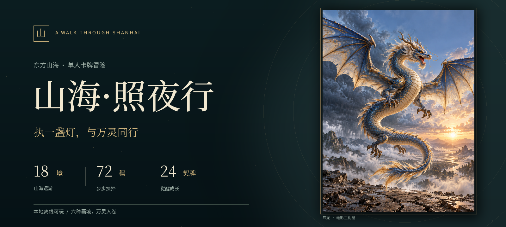
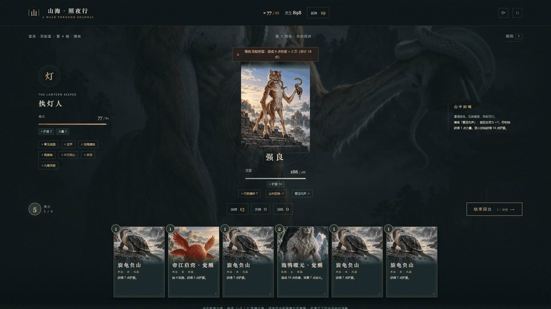
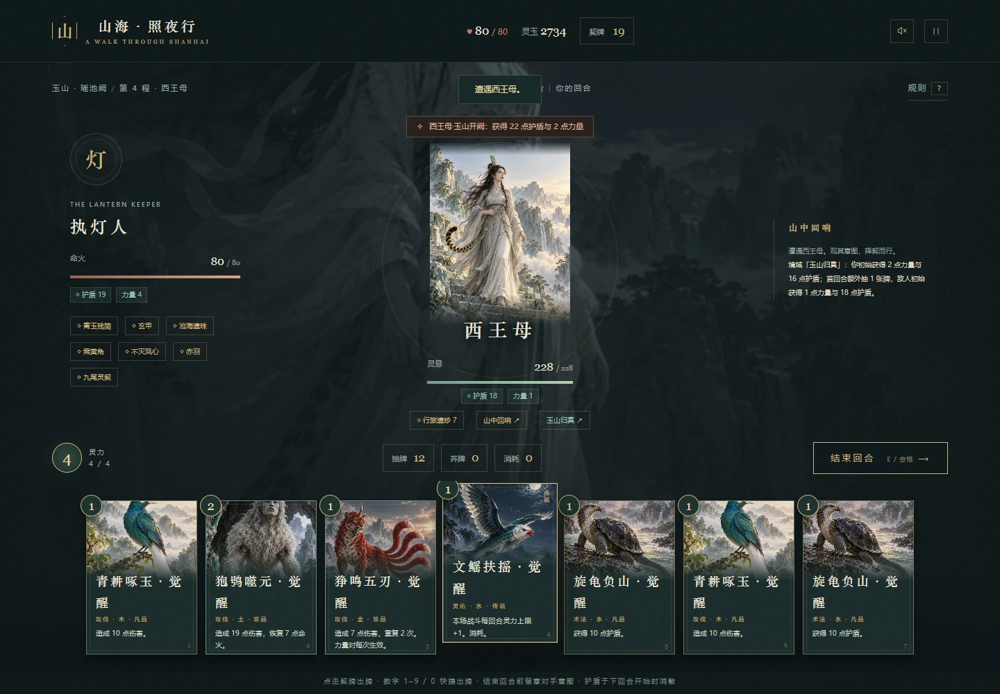
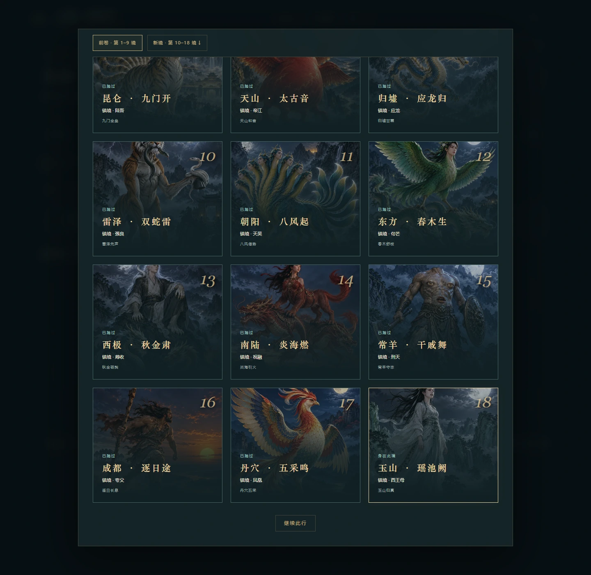
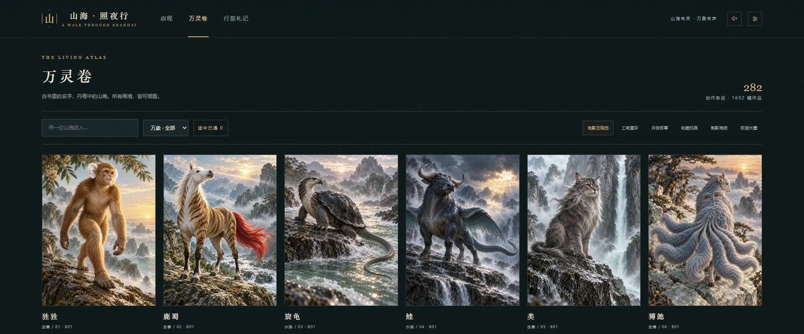
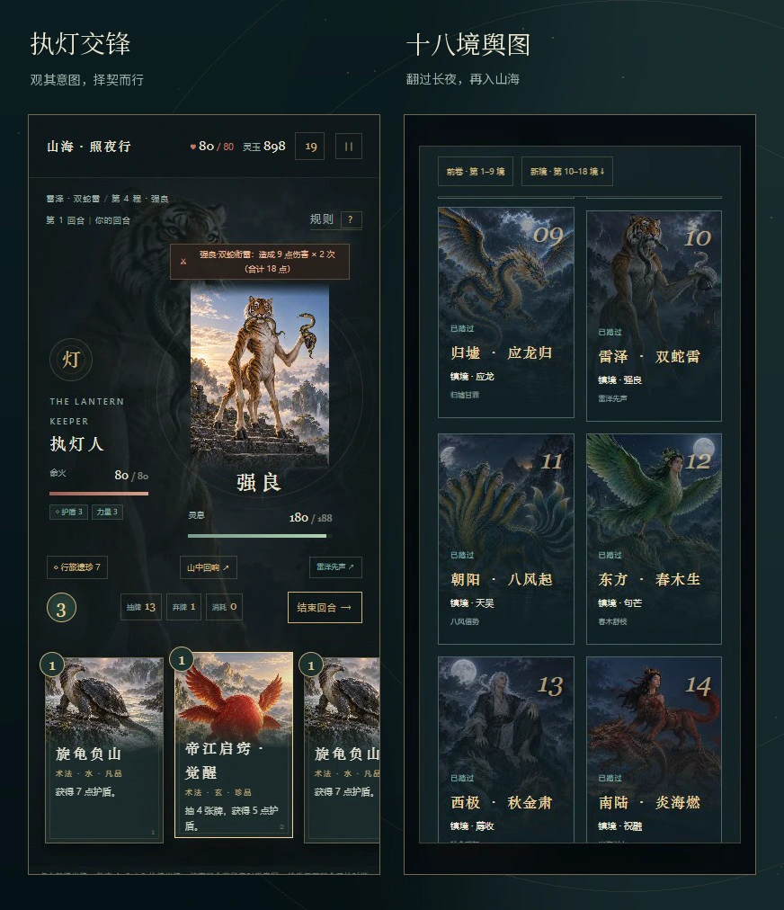
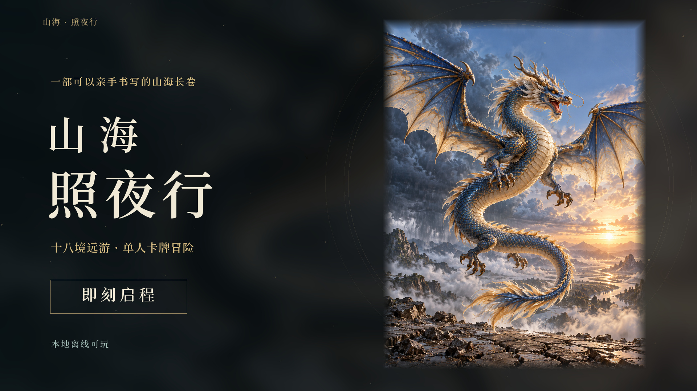

# 山海·照夜行

[](https://zslpzdzh.github.io/shanhai-zhaoyexing/)

**一盏灯，一副契牌，一程山海。**

一款以《山海经》题材原画与考据为底本的单人卡牌冒险：观察异兽意图，构筑自己的牌组，在奇遇、行商与首领试炼之间走过十八境。

**[立即试玩](https://zslpzdzh.github.io/shanhai-zhaoyexing/)　·　[观看宣传片](https://zslpzdzh.github.io/shanhai-zhaoyexing/trailer/)　·　[下载离线版](https://github.com/ZSLPZDZH/shanhai-zhaoyexing/releases/latest)**

<p align="center">
  <strong>18 境 · 72 程</strong>　｜　54 种对手　｜　24 张基础契牌　｜　7 件遗珍<br>
  3 种流派　｜　3 档难度　｜　21 项成就<br>
  282 个创作条目　｜　1,692 幅作品　｜　6 种画境
</p>

## 落下一张契牌，改写下一回合



| 择一条前路 | 看清异兽意图 | 养成自己的牌组 | 迎接镇境之灵 |
| --- | --- | --- | --- |
| 战斗、奇遇、行商与休憩，留下不同的行迹。 | 用有限灵力安排攻击、护盾、灼烧与疗伤。 | 战后收契，灵泉觉醒，行商购牌、寻珍或删牌。 | 跨过境域法则与首领轮转，继续下一章。 |

每张基础契牌都可觉醒；战后也可以跳过新牌，留下更精简的行囊。命火归零时结束本次远游，结缘、成就与札记继续保留。

<table>
  <tr>
    <td width="50%"><br><strong>先观势，再结契。</strong><br><sub>多段攻击逐段结算护盾与反伤。</sub></td>
    <td width="50%"><br><strong>山川有序，各有法则。</strong><br><sub>舆图预览前路，旅程按章节顺序推进。</sub></td>
  </tr>
</table>

## 三种流派，各有破局之道

| 流派 | 起始命火 | 打法 | 初始遗珍 |
| --- | ---: | --- | --- |
| **执灯 · 均衡** | 80 | 青耕攻伐、旋龟守御，白鵺周转灵契。 | 青玉残简，战后疗愈。 |
| **逐焰 · 灼烧** | 74 | 毕方与肥遗累积灼烧，精卫维持命火。 | 赤羽，每场战斗获得力量。 |
| **听潮 · 守御** | 86 | 赤鱬与旋龟守御，精卫疗伤、天马周转。 | 玄甲，每回合获得护盾。 |

难度可选 **寻幽 / 远行 / 问道**。相同种子、流派、难度与行动可以重现同一局；结算后可重走这段山海。

## 这一回，想走多远

新旅程默认 **山海全卷**。六种篇幅各有完整终点，可从三境初行开始，也可以一路走到玉山。

| 卷册 | 篇幅 | 路程 | 终章试炼 |
| --- | ---: | ---: | --- |
| 初卷 | 3 境 | 12 程 | 烛龙 |
| 远卷 | 6 境 | 24 程 | 九凤 |
| 九境卷 | 9 境 | 36 程 | 应龙 |
| 远征卷 | 12 境 | 48 程 | 句芒 |
| 大荒卷 | 15 境 | 60 程 | 刑天 |
| 山海全卷 | 18 境 | 72 程 | 西王母 |

从青丘月色、扶桑晨曦，到雷泽双蛇、常羊干戚与玉山归卷，后续境域带来各自的开局法则。原有三、六、九境存档保留原篇幅与终点；新开全卷即可体验全部关卡。

## 前路之外，还有一部万灵卷

万灵卷收录 **282 个创作条目、1,692 幅作品**，支持搜索、题材与结缘筛选。打开条目，可以在六种画境间切换，同时阅读原文、出处、考据与创作边界。

**电影主视觉 · 工笔重彩 · 月夜叙事 · 收藏玩具 · 剪影海报 · 极简水墨**

<table>
  <tr>
    <td width="65%"><br><strong>一灵六境，万象入卷。</strong></td>
    <td width="35%"><br><strong>也可在手机上执灯远行。</strong><br><sub>触控出牌，横向滑动手牌。</sub></td>
  </tr>
</table>

“282”按创作条目计数，包含同名、复用、替代与现代备稿。游戏能力、五行、稀有度与剧情为艺术演绎，文献信息以各条目的原文及考据为准。

## 一分钟，先看一段远游

[](https://zslpzdzh.github.io/shanhai-zhaoyexing/trailer/)

**[打开宣传片页面 →](https://zslpzdzh.github.io/shanhai-zhaoyexing/trailer/)**

## 开始你的旅程

- **在线游玩**：打开[游戏页面](https://zslpzdzh.github.io/shanhai-zhaoyexing/)，无需安装或账号。
- **离线游玩**：从 [Releases](https://github.com/ZSLPZDZH/shanhai-zhaoyexing/releases/latest) 下载离线包，完整解压后用 Chrome 或 Edge 打开 `index.html`。
- **接续存档**：旅程自动保存在当前浏览器。网页版、本地文件、本地服务器三种入口分别保存进度；切换入口或设备时，在设置或札记中导出、导入 JSON 存档。

键盘可用 **1–9 / 0** 出牌、**E** 结束回合、**Esc** 暂停、**?** 查看规则。手机支持触控操作。完整的战斗、难度、觉醒、成就与存档说明见 **[游玩指南](docs/GAME_GUIDE.md)**。

## 开发与验证

[](https://github.com/ZSLPZDZH/shanhai-zhaoyexing/actions/workflows/verify.yml)

游戏由静态 HTML、CSS 与 JavaScript 构成，资源随项目提供。规则与存档校验可在仓库根目录运行：

```sh
node engine-test.cjs
node --test profile-test.cjs
```

本地预览：

```sh
python -m http.server 4187
```

然后访问 [http://localhost:4187](http://localhost:4187)。`engine.js` 管理旅程与战斗，`profile.js` 管理成就、历史和存档，`data.js` 与 `assets/` 保存图鉴资料及媒体；介绍与指南位于 `docs/`，宣传片入口位于 `trailer/`。

## 来源与资源

本项目以六批次《山海经》配图、创作稿和原文考据为底本，保留分项、替代题名与文献边界。完整来源稿与清单位于 [assets/sources](assets/sources)。游戏使用 WebP 浏览副本，原 PNG 与原始命名另行保留。

源码、美术与配乐使用项目现有素材，目前未另行授予开源许可。
